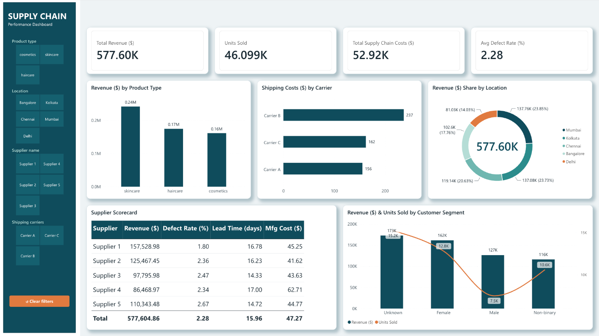

# Power BI Dashboards

A growing collection of interactive Power BI dashboards. Each one has a screenshot, a live report and a write-up of the data and insights.

**Gallery site:** [rachelnetherlands.github.io/powerbi-dashboards](https://rachelnetherlands.github.io/powerbi-dashboards/)

## Dashboards

| | Dashboard | Domain | Highlights |
|---|---|---|---|
| <a href="dashboards/supply-chain-performance/"></a> | **[Supply Chain Performance](dashboards/supply-chain-performance/)**<br>Oct 2026 | Supply chain | Revenue, costs, supplier scorecard, customer segments; tile slicers and cross-filtering |

## Repository layout

```
powerbi-dashboards/
├── index.html              # gallery site (GitHub Pages), built from dashboards.json
├── dashboards.json         # one entry per dashboard
└── dashboards/
    ├── _template/          # copy this to start a new dashboard
    └── <dashboard-slug>/
        ├── README.md       # write-up: overview, insights, data, limitations
        ├── index.html      # page with screenshot + live embed
        └── assets/         # screenshot.png, theme.json, ...
```

## Adding a new dashboard

1. Copy `dashboards/_template/` to `dashboards/<new-slug>/`.
2. Add `assets/screenshot.png`, then fill in `README.md` and the embed link in `index.html`.
3. Add an entry to `dashboards.json`. The gallery site picks it up automatically.
4. Add a row to the table above and a card on the [profile README](https://github.com/rachelnetherlands/rachelnetherlands).
